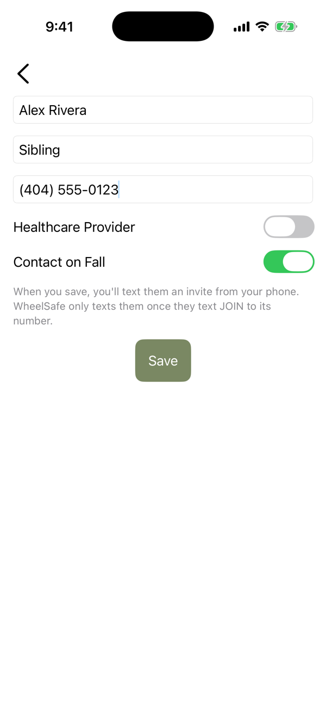
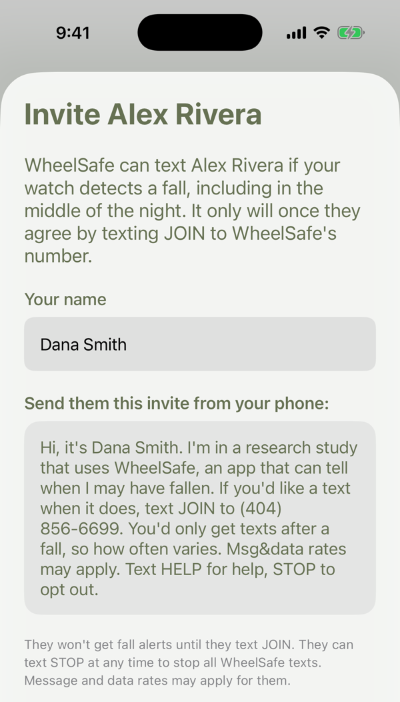
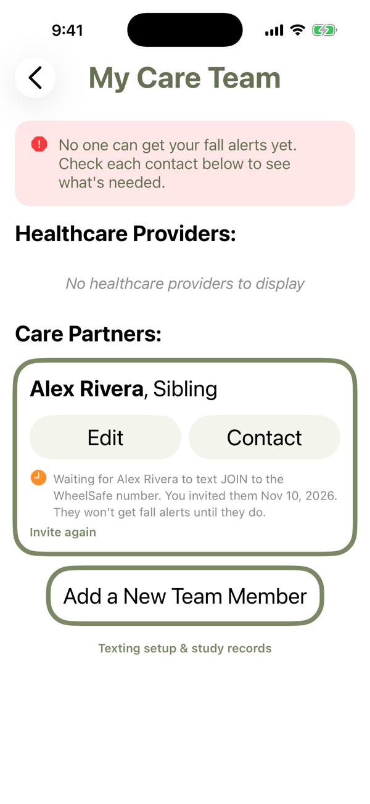
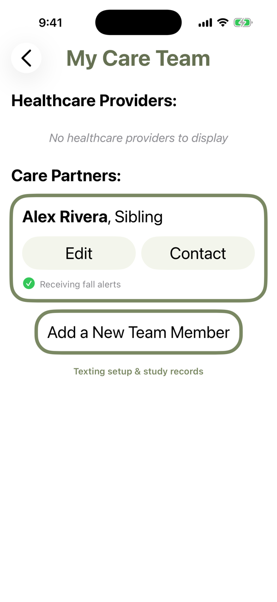
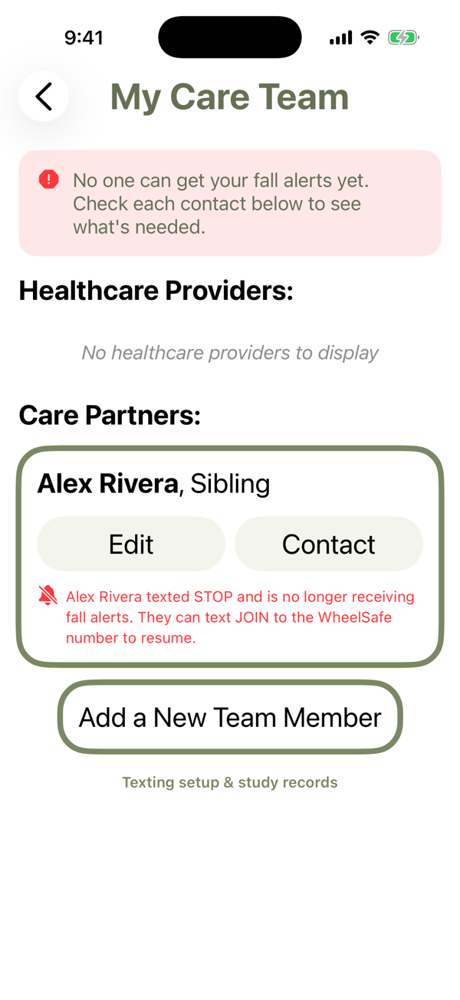

# How contacts opt in to WheelSafe fall alerts

WheelSafe texts a participant's emergency contacts only after the contact **texts JOIN to the WheelSafe number themselves**. That text is the consent of record. WheelSafe never texts a number that hasn't texted it first.

In the screenshots, the participant is Dana Smith and the contact is Dana's sibling, Alex Rivera.

1. **The participant adds the contact.** In the WheelSafe iPhone app, under My Care Team, the participant enters the contact's name and mobile number and turns on **Contact on Fall**. Nothing is sent.

   

2. **The participant invites them from their own phone.** The app opens Messages with this invite filled in and addressed to the contact, and the participant sends it as an ordinary text of their own:
   > Hi, it's Dana Smith. I'm in a research study that uses WheelSafe, an app that can tell when I may have fallen. If you'd like a text when it does, text JOIN to (404) 856-6699. You'd only get texts after a fall, so how often varies. Msg&data rates may apply. Text HELP for help, STOP to opt out. Terms & privacy: https://david-peeler.github.io/wheelsafe-texting/

   

3. **The contact texts JOIN to the WheelSafe number.** WheelSafe replies with a confirmation, its first text to them:
   > WheelSafe: You're now a fall-alert contact. You'll get a text only if the WheelSafe user who invited you may have fallen; frequency varies. Msg&data rates may apply. Reply HELP for help, STOP to opt out.

   Only then are they added to the alert list. A contact who doesn't text JOIN never hears from WheelSafe. Until they do, the app shows the participant that they're waiting; after, that they're receiving alerts:

    

4. **Opting out.** The contact can text STOP at any time. The app detects it and shows the participant that the contact is no longer receiving alerts.

   

[Terms & Conditions](https://david-peeler.github.io/wheelsafe-texting/terms-and-conditions.html) · [Privacy Policy](https://david-peeler.github.io/wheelsafe-texting/privacy-policy.html)
